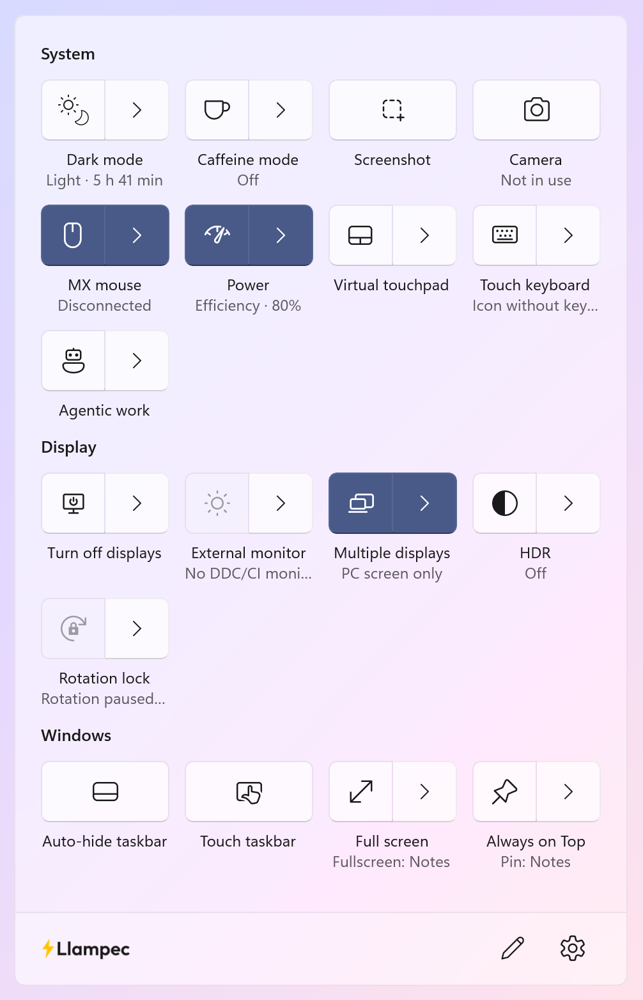

  <picture>
    <source media="(prefers-color-scheme: dark)" srcset="docs/images/logo-horizontal-dark.svg">
    
  </picture>

  <b>The quick settings panel I always wanted Windows 11 to have.</b> 
  Small, fast and one click away in the notification area.

  <a href="https://github.com/PereEsquerdo/Llampec/releases">Download</a> ·
  <a href="docs/USING.md">How to use it</a> ·
  <a href="docs/DEVELOPMENT.md">Build it yourself</a>

  <picture>
    <source media="(prefers-color-scheme: dark)" srcset="docs/images/panel-dark.png">
    
  </picture>

*Llampec* means "lightning" in Catalan/Valencian. It sits next to the clock and gives you the
switches Windows keeps hiding three menus deep, plus a few it never had. It stays out
of the way: it only changes existing Windows settings, and while you're not using it
it does nothing at all.

## What it does

- **Windows:** keep any window on top (and undo it when another app did it), make
  any window full screen, hide the taskbar or switch to the touch taskbar.
- **Displays:** HDR per monitor, brightness, contrast and volume of external
  monitors, turn off just one screen, switch display modes, lock or change rotation,
  and bring back a monitor that stays black after sleep.
- **System:** dark mode on a schedule (even sunrise to sunset), caffeine mode, power
  mode and lid actions, a camera light that tells you which app is using it, quick
  screenshots, and the touch keyboard and virtual touchpad.
- **Logitech MX mice:** shortcuts on the extra buttons, DPI, the scroll wheel and
  battery level, without Logi Options+.
- **Agentic work:** leave the PC working for AI agents or remote access with the
  screens dark. No standby, no lock, no OLED wear, and a key press brings everything
  back.

Arrange it your way: choose columns, make categories and drag buttons around, just
like Windows Quick Settings. Llampec speaks English, Spanish and Catalan/Valencian.

## A bit of history

The first Llampec was a small internal tool I made in 2016 for the development and
design company (Impuls). Windows 10 was missing a few things we needed every day,
so I wrote them: pinning a window on top, a caffeine mode to keep the PC awake,
turning off the monitor, full screen for any window and, once Windows finally added
it to Settings, a dark mode switch. It was text only and did just those few things,
but we used it constantly.

Ten years later I rebuilt it from scratch for today's Windows 11 and for the way I
work now, a lot of it alongside AI agents. It has a proper interface now, many more
controls and the same idea as back then: fix the small things Windows doesn't.

## Install

Download the installer or the portable ZIP for your PC (ARM64 or x64) from
[Releases](https://github.com/PereEsquerdo/Llampec/releases). You need Windows 11 24H2
or later and the [.NET 10 Runtime](https://dotnet.microsoft.com/download/dotnet/10.0);
the installer tells you if it's missing. No administrator rights needed.

The builds aren't code-signed yet, so SmartScreen may ask you to confirm
(**More info → Run anyway**).

Open the panel with its icon in the notification area or **Ctrl+Alt+Space**.
[How to use it](docs/USING.md) covers each feature.

## Privacy

No telemetry, no accounts, no network calls of its own. Settings live in
`%LOCALAPPDATA%\Llampec\settings.json`. Location is only used if you ask for
sunrise and sunset times, and then it's saved so the rest works offline.

## What's next

Network settings, wireless projection, webcam controls and quick access to the
volume and brightness panels. Same rule as always: quick access to what Windows
already has, no deep system changes and no cost while idle.

## Thanks

- [Microsoft PowerToys](https://github.com/microsoft/PowerToys), whose Always on Top
  inspired mine.
- [Mouser](https://github.com/TomBadash/Mouser) by Tom Badash, for the Logitech
  HID++ code I adapted, and [Solaar](https://github.com/pwr-Solaar/Solaar) for the
  protocol notes.
- [Outfit](https://github.com/Outfitio/Outfit-Fonts), the typeface in the logo.

Details and licenses are in [Acknowledgements](docs/ACKNOWLEDGEMENTS.md).

<i>Dedicat a Lara i a Miquel 🫶</i>

## License

[MIT](LICENSE) · © 2026 [Pere Esquerdo Ramis](https://github.com/PereEsquerdo)
